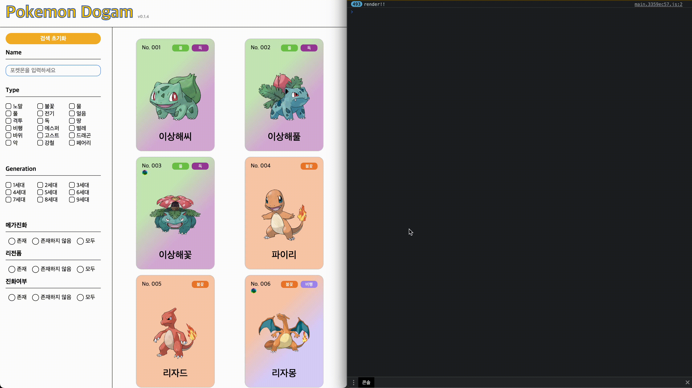
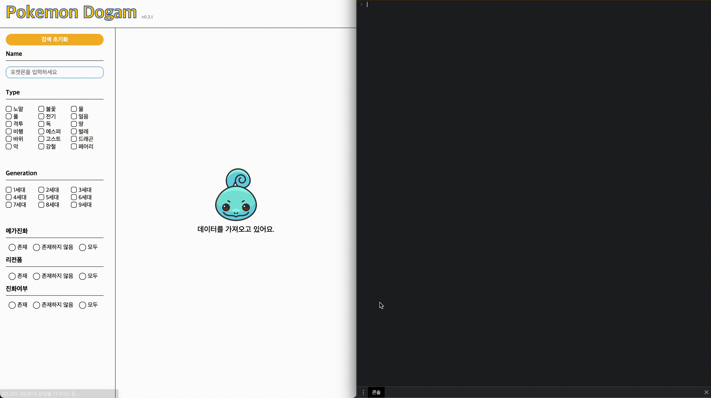
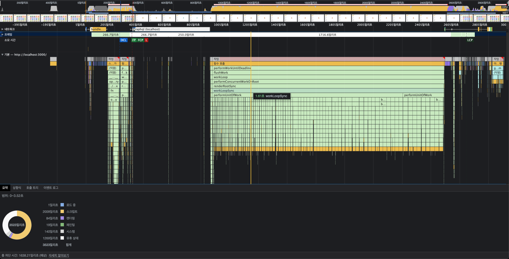
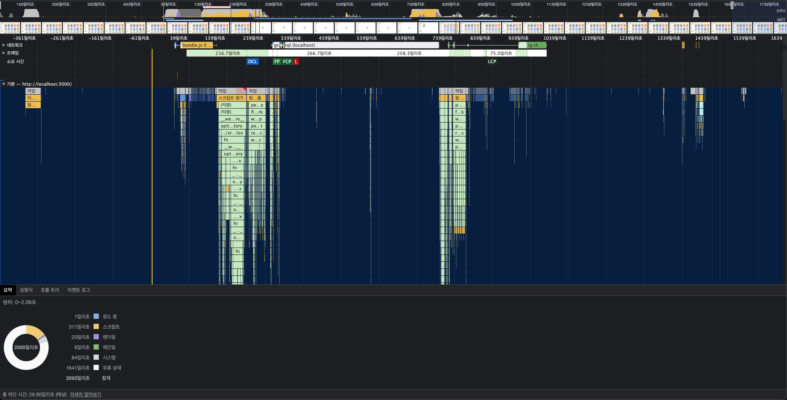

# 업데이트 개발 노트

안녕하세요 이번 포스팅에서는 0.2.0버전 업데이트시 적용했던 리스트 렌더링에 적용했던 기술을 적어보려고 합니다.
읽어보시고 잘못된 내용이나 오타가 있을시 알려주시면 빠르게 수정하여 업데이트 하겠습니다.

## 기존 방식

### 문제점

이번 업데이트가 진행되기 전까진 페이지에 있는 화면이 표시될 때 포켓몬의 데이터를 모두 가져온 뒤, 포켓몬 수 만큼 모든 카드를 한꺼번에 그리고 화면에 표시했습니다.
처음 1세대, 2세대까지의 포켓몬을 업데이트했을 시점에서는 모든 포켓몬에 대한 카드를 그리고 표출하기까지 많은 시간이 걸리지 않아 큰 문제가 될것이라고 생각하지 않았습니다.

하지만, 3세대를 추가함에 따라 포켓몬의 수가 386개가 됨에 따라 카드를 만들 때의 컴포넌트들, 이미지들이 한꺼번에 가져옴에 따라 로딩 시간이 길어지는 문제가 발생했습니다.
첫 화면 진입시 최소한의 요청을 가져올 수 있도록 하기 위해 이미지를 불러오는 부분을 **lazy loading**[^1] 방식으로 변경하였지만 근본적인 카드를 모두 생성하는 문제가 있어 큰 효과를 볼 수 없었습니다.

### 카드 최적화

#### 적용 전

가장 문제가 되는 부분은 **카드 컴포넌트 자체의 렌더링**이었습니다.
카드 컴포넌트에는 태그, 이미지 컴폰너트와 함께 메가진화나 리전폼 유무에 따라 표시되는 아이콘 등 여러 컴포넌트가 합쳐져있기 때문에 카드를 생성하게 된다면 내부에 있는 모든 컴포넌트들도 함께 반복적으로 렌더링을 하게 됩니다.

1. 적용 전 페이지 렌더링
   
   카드의 렌더링을 확인하기 위해 카드 컴포넌트에 컴포넌트를 불러올 때 로그를 넣어 확인을 해보았습니다.
   확인 결과 페이지가 표시될 때 모든 카드(=포켓몬의 수)만큼 카드가 생성되는것을 확인하실 수 있습니다.
   현재 화면에 보여지는 카드의 수는 10개 미만이지만 렌더링 되는 카드는 400개가 넘어 불필요한 렌더링이 매우 많이 이루어졌습니다.
   또한 이렇게 불필요한 렌더링으로 인해 로딩시간이 길어져 사용자의 접근성이 떨어졌습니다.

#### 적용 라이브러리

위와 같은 문제로 인해 최적화 방법을 찾던 중 `react-virtuoso`라는 라이브러리를 이용하여 최적화를 진행하기로 했습니다.
`react-virtuoso`는 많은 리스트를 모두 보여주는것이 아닌 화면 사이즈에 맞추어 처음 보여지는 부분에 대한 컨텐츠를 로드하는 방식을 이용합니다.
화면에 보여지는 부분에 대해서 카드를 생성하고 스크롤을 내려 다른 카드영역으로 이동될 때 해당 영역에 대한 카드만 렌더링한 뒤 보여주는 방식으로 동작하기 때문에 불필요한 렌더링을 매우 많이 줄일 수 있었습니다.

#### 적용 후

1. 적용 후 페이지 렌더링
   
   페이지가 새로고침되며 데이터를 가져오고 데이터를 이용하여 카드가 생성될 때 렌더링되는 카드는 화면 개수에 맞는 6개가 렌더링 되고 이후 스크롤을 내릴때 마다 카드의 수에 맞게 로그가 추가되는것을 확인하실 수 있습니다.
   이러한 수정으로 불필요한 렌더링이 줄어듦에 따라 페이지의 로딩 시간이 눈에 띌 정도로 단축된 것을 알 수 있습니다.

#### 성능 차이

그렇다면 성능적인 부분에서는 얼마나 차이가 있을지 확인해보았습니다.
사용한 방식은 개발자 도구에 있는 성능 탭을 이용해 확인했습니다.

1. **적용 전 성능**
   
   적용 전에는 스크립트를 불러오는 시간이 약 2000ms => 2초가 걸리며 유휴 상태를 제외한 시간이 2초가 넘는것을 알 수 있습니다.

2. **적용 후 성능**
   
   적용 후 성능탭을 이용하여 측정하였을 때, 스크립트는 2000ms에서 1700ms가량 줄어든 약 310ms으로 매우 큰 차이를 보이고 있었고 다른 렌더링, 페이팅 부분에서도 시간이 단축된 것을 확인하실 수 있습니다.
   이러한 최적화로 적용 후에는 유휴상태를 제외했을 때 500ms정도의 시간으로 **기존 적용전 대비 25%로 단축**되었습니다.

### 결과

이번 최적화 작업을 통해 사용자가 페이지를 로딩시간이 단축되었으며 불필요한 메모리를 줄이고 빠르게 이용할 수 있도록 업데이트 되었습니다.
이러한 적용으로 조금 더 최적화에 대한 부분에 신경을 쓰고 어떠한 부분에 어떠한 작업을 해야 조금 더 좋은 경험성을 제공할 수 있는지 이해할 수 있는 작업이 되었습니다.

모든 소스코드는 공개중이며 오타나 잘못된 부분이 있다면 언제든 알려주시면 최대한 빠른 시일내에 수정하겠습니다.

감사합니다.

### 추가 첨부 자료

1. 적용 전 성능 표
   [파일 다운로드](./file/performance_before.gz)
2. 적용 후 성능 표
   [파일 다운로드](./file/performance_after.gz)

   [^1]: **페이지에 액세스할 때 모든 콘텐츠를 대량으로 로드하는 대신 사용자가 필요한 부분에 대해 일부만 로드하는 방식**
