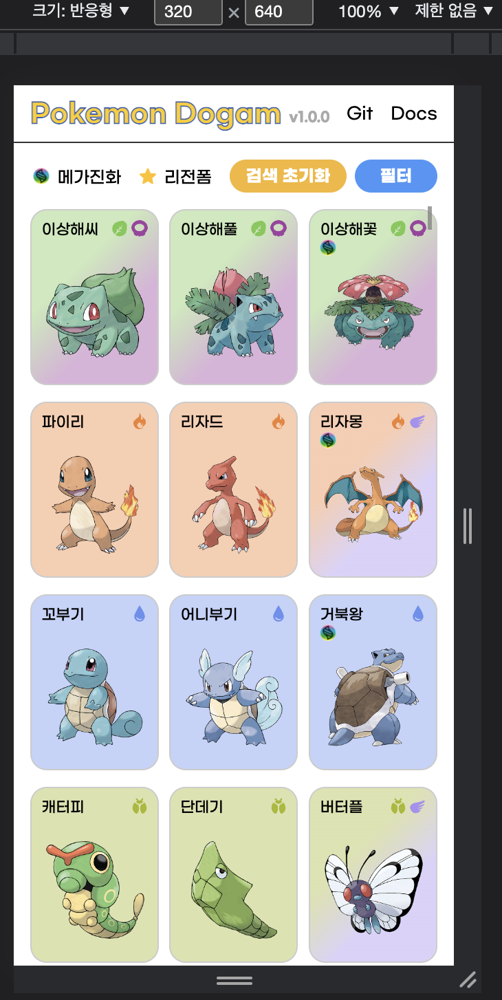
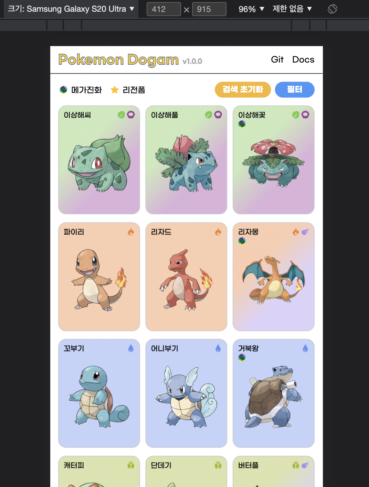
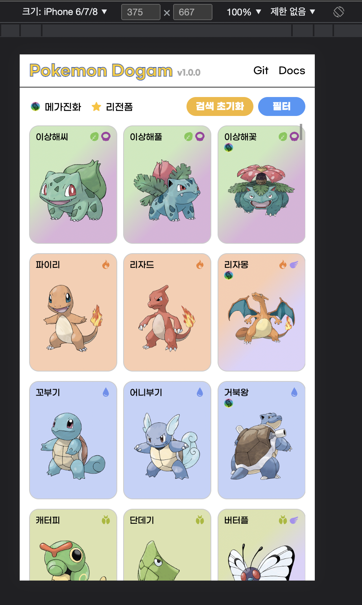

안녕하세요 오늘은 이번 1.0.0 업데이트에서 수정되었던 부분 중 텍스트 사이즈와 그에 맞춰 스타일을 수정하는 과정에 대해 포스팅하려고 합니다.

## 기존 방식

- 기존 코드에서는 스타일을 적용할 때 반응형에 맞추어 모든 사이즈를 `rem`으로 지정하여 적용하고 있었습니다.
- 또한 사용하는 환경에 따라 폰트의 크기가 일치하지 않아 텍스트의 길이가 2줄이 되거나 일부 기기에서는 정상적으로 나오는 카드의 모양이 정사각형 모양으로 변하는 등의 ui적인 부분에 대한 이슈가 있었습니다.
- 해당 방식에서는 사이즈의 경우 조금 더 여유있는 수치로 늘려주는 방법을 먼저 적용하였지만 기본으로 제공하는 폰트의 차이가 존재하기 때문에 공통된 디자인을 보여줄 수 없었습니다.

## 해결 방법

- 먼저 폰트의 경우 현재 제공하는 사이트의 분위기와 사용하는 연령대들을모두 포괄하여 거부감 없이 이용할 수 있는 폰트를 적용하여 os가 달라도 같은 화면을 볼 수 있도록 하였습니다.
- 카드의 모양이 정사각형이 되는 부분에 대한 수정사항으로는 `grid` 속성을 이용하여 자동으로 맞추어 주었는데 이렇게 자동으로 맞추다보니 브라우저의 사이즈에 따라 정사각형으로 보이는 이슈가 있었습니다.
- 기존 카드의 방식은 세로모양의 직사각형을 둥글게 만들어 주기로 정했기 때문에 해당 부분에 대한 ui를 `clamp`함수를 이용하여 수정하기로 했습니다.

### clamp

- `clamp`함수는 css내부에서 사용하는 함수로 적용하려는 요소의 최솟값, 선호값, 최댓값을 정해주며 최소와 최대를 넘지 않는 범위에서는 가변형으로 사이즈를 조정할 수 있도록 해주는 함수 입니다.
- 함수는 세개의 인자값을 가질 수 있는데 순서대로 최솟값, 선호값, 최댓값을 적용하여 줄 수 있습니다.
- 기본적으로 선호하는 값의 수치가 최소, 최대를 넘지 않아야 하기에 선호값은 `vw`, `%`와 같은 상황에 따라 변할 수 있는 값을 적용하고 최소와 최대는 `px`, `rem`과 같이 고정이 될 수 있는 값을 적용합니다.
- 현재 사이트에서는 사용하는 기기 너비에 에 맞추어 카드의 비율과 모양을 지정해주기 때문에 `height`의 값을 `clamp(최솟값, 선호값, 최댓값)`으로 모바일 기준 최소 `10rem`, 최대 `14rem`을 지정하고 선호값은 `40vw`로 사용하였습니다
- 반응형을 위한 미디어쿼리를 적용하지 않고도 해당 함수를 이용한다면 PC, Mobile에서 반응형에 맞추어 크기를 지정해줄 수 있습니다.

## 결과

위와같이 사용하는 모바일 기기와 모바일기기에서 표시하는 사이즈가 아닌 반응형에따라 너비가 최소 320px의 사이즈 까지에서 모두 원하고자 하는 카드의 표시 방식을 적용할 수 있게 되었습니다.
또한 해당 함수를 사용하여 크기를 조정함에 따라 개별적인 미디어쿼리를 어느정도 줄이게 되어 전체적인 코드량을 줄일 수 있었습니다.

---

## 관련 링크

MDN clamp : <https://developer.mozilla.org/en-US/docs/Web/CSS/clamp>
