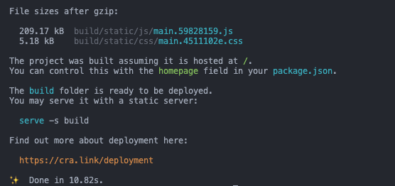
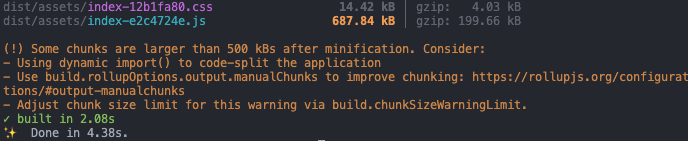

안녕하세요 이번 업데이트를 진행하며 변경했던 개발적인 기술 중 기존 Webpack 번들러를 Vite로 변경하고 알아보는 글을 작성하려고 합니다.

## 읽기 전에

이번 포스팅은 현재 프로젝트 기준으로 어떤게 더 효율적인지 비교하고 사용하게 된 계기를 알리려고 작성한 글 입니다.
**절대 '어떤 번들러가 더 우위에 있고 해당 번들러를 사용해야만 한다' 라는 의도는 없으며 지극히 주관적인 견해와 경험을 바탕으로 작성하였습니다.**

## VITE?

vite는 Vue.js의 창시자라고 할 수 있는 Evan You가 개발한 번들러이며 가장 큰 장점은 이름에서 표현하듯 **속도**입니다.
처음 출시에는 Vue.js와 함께 사용이 가능했지만 현재 React, Svelte와같은 다른 Frontend Framework, Library에서도 사용이 가능합니다.

## 특징

Vite는 로컬에서 개발을 진행할 때 기존 번들링 기반 도구와 달리 **ESM**방식을 이용하기 때문에 서버 구동속도가 매우 빠르다는 특징이 있습니다.

### ESM(ECMAScript Module)

ESM은 ECMAScript에서 지원하는 자바스크립트 공식 모듈인데요 ESM을 이용하면 우리가 개발할 때 자주 사용하는 `import`, `export`를 이용해 분리된 자바스크립트의 파일을 접근할 수 있게 됩니다

### 개발 서버에서의 속도

Webpack의 경우 ㅁ소스코드와 모든 종속 관계의 모듈을 번들링 한 뒤에 서버가 준비가 됩니다
하지만 Vite의 경우 코드를 dependencies, source cord 두가지로 나누어 개발 서버를 시작하기 때문에 빠른 구동 시간을 가지게 되죠 (=**HMR**)

### HMR(Hot Module Replacement)

앱을 종료하지 않고 갱신된 파일만을 교체하는 방식입니다.
Node.js를 이용하여 서버를 구성할 때 nodemon이라는 library를 이용하여 개발하는 것과 같은 기능을 동작하게 합니다

Vite의 경우 ESM을 이용하여 HMR을 지원하게 되는데

1. 어떠한 모듈이 수정되면 전체적인 코드를 갱신하지 않고 수정된 모듈과 관련된 부분만을 교체 후 적용합니다.
2. 일부 번들러의 경우에는 메모리 상에서 실제로 갱신에 영향이 있는 파일들만 번들링하지만 이 방법 역시 처음 모든 파일에 대한 번들링을 진행해야 하는 부분이 있어 해당 부분에서도 보다 더빠르다는 이점을 가지고 있습니다.

### 번들링

현재 vite의 경우 `ESbuild`를 사용을 하고 있지만 번들링에 필수 기능인 코드 분할과 CSS와 관련된 처리가 아직 불안정 하기 때문에 `Production` 빌드시에는 `Rollup`을 사용하여 빌드를 지원하고 있습니다.
해당 부분에성 추후 `ESbuild`가 안정화 됐을 경우에는 변경될 가능성이 있다고 합니다

## 사이트에 적용해보기

기존 프로젝는 기본 CRA를 통해 생성한 `Webpack` 번들링 기반의 프로젝트였습니다.
코드가 늘어나고 개발서버에서 수정 후 수정된 상태의 코드를 실행시키기 위해 많은 시간이 소요되며 production 빌드시에도 더 가벼운 빌드를 위해 변경을 진행하였습니다.

### 비교

#### webpack

기존 Webpack으로 빌드가 되었을 때는 js파일이 209.17kb, css파일이 5.18kb로 번들링 되었으며 빌드가 완료되기까지 10.82초가 지났습니다.

#### Vite

Vite의 경우에는 js 파일이 199.66kb, css파일은 4.03kb로 빌드되었으며 모든 빌드가 완료되기까지 4.38초가 소모되었습니다.

#### 결과

현재 프로젝트에서는 결과적으로 Vite로 빌드를 하는것이 webpack과 비교했을 때 약 4.5%, css의 경우에는 약 22%의 성능이 향상 되는것을 볼 수 있었습니다.
또한, 빌드가 되는 시간도 50% 이상의 빠른 속도로 빌드가 되는것을 확인하여 포켓몬 프로젝트의 번들러는 webpack에서 vite로 변경하는것이 더 좋다는 결과를 얻을 수 있게 되었습니다.

| 번들러                                           | js                      | css                     | 빌드 시간                    |
| ------------------------------------------------ | ----------------------- | ----------------------- | ---------------------------- |
| Webpack                                          | 209.17kb                | 5.18kb                  | 10.82s                       |
| Vite                                             | 199.66kb                | 4.03kb                  | 4.38s                        |
| **비교 결과** | Vite가 9.51kb 더 가벼움 | Vite가 1.15kb 더 가벼움 | Vite가 6.44초 더 빠르게 빌드 |

## Vite가 무조건 좋은건 아닙니다

이번 프로젝트에서는 Webpack과 Vite 두 가지를 비교해보고 더 좋은 결과가 나타난 Vite를 사용하기로 했지만 결코 Webpack이 Vite에 뒤쳐지는 번들러 라는걸 알리려는 의도는 없으며 지극히 개인적인 판단이 들어가있습니다.
현재 프로젝트에서는 Vite가 더 효율적이지만 다른 프로젝트에서는 Webpack이 더 효율적일수도 있으며 흔히 사용하는 `process.env`, 이미지를 호출할 때 사용하는 `require()`와 같이 webpack에서 지원하는 함수를 사용할 수 없거나 다르게 작성해야 하는 부분도 있기 때문에 상황, 프로젝트의 규모 등으로 어떤 번들러를 사용할지 자유롭게 비교해보고 선택하시면 될 것 같습니다.
