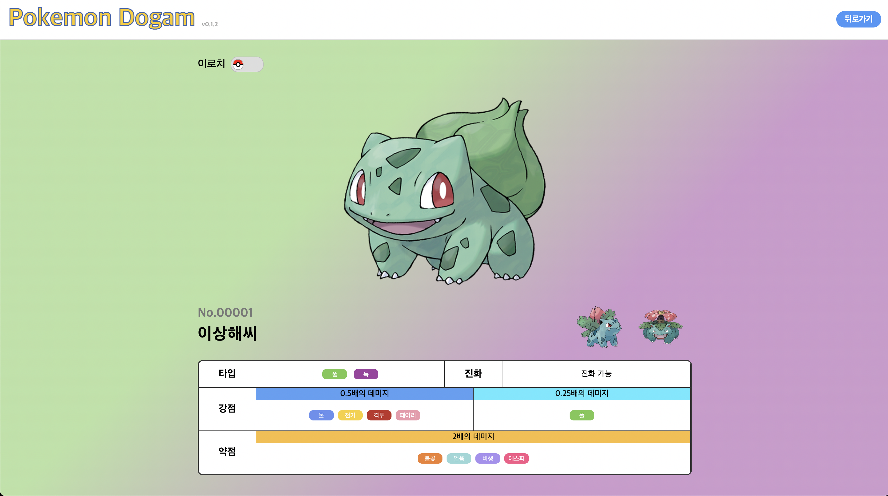

## 상세화면 안내사항

포켓몬에 관한 여러 정보를 볼 수 있는 상세페이지안내 입니다.

### 포켓몬 정보

- 포켓몬에 관련된 기본 정보를 표시합니다.
- 타입 상성, 연관된 포켓몬, 리전폼, 이로치 등의 정보를 확인하실 수 있습니다.
- 화면 중앙 하단에 나와있는 정보는 해당 포켓몬이 메가진화, 리전폼을 활성화 했을 경우 해당 변경된 정보가 표시됩니다.
  - **예) 리전폼의 경우 해당 지역이 표시됩니다.**

### 기능

- **이로치:**

  - 화면 **좌측 상단** 스위치 버튼으로 해당 포켓몬의 이로치 모습을 확인하실 수 있습니다.
  - **이로치모습을 활성화 한 상태에서 다른 연관 포켓몬으로 이동시에도 이로치는 활성화 상태를 유지합니다.**

- **메가진화, 리전폼**
  - 해당 포켓몬이 리전폼, 메가진화 상태를 보유했을 경우 **우측 상단** 스위치로 해당 모습을 확인하실 수 있습니다.
  - **리전폼과 메가진화를 모두 가지고 있을 경우 해당 스위치 버튼은 라디오 버튼으로 변경**되어 두 모습 모두 확인하실 수 있습니다.
