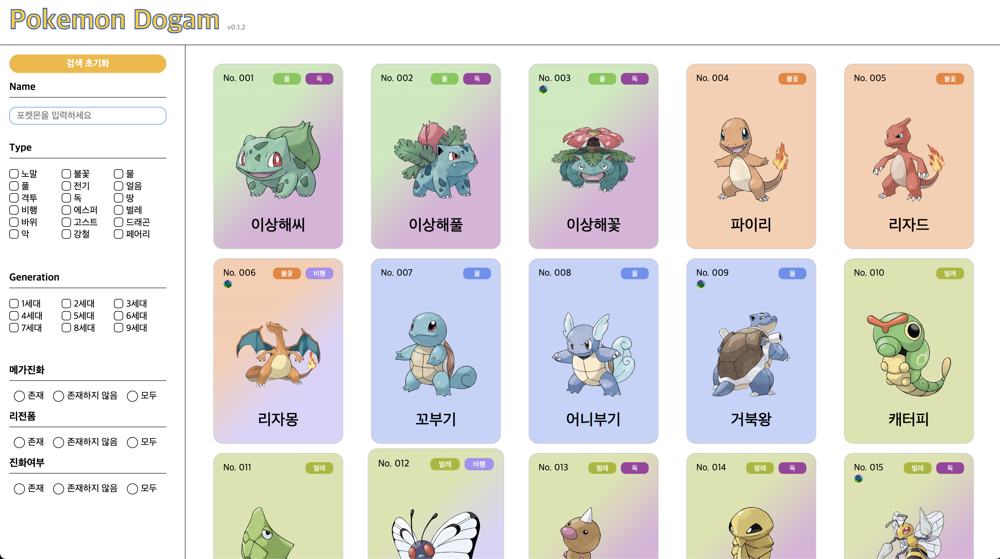

## 메인화면 안내사항

메인 페이지 리스트에 관한 사용안내 입니다

## 기능

### 포켓몬 리스트

- 포켓몬 리스트 카드를 선택하여 해당 포켓몬의 상세 정보를 볼 수 있는 페이지로 이동합니다.
- 포켓몬 카드의 배경색으로도 해당 포켓몬의 타입을 알 수 있습니다.
- 포켓몬은 **전국도감 기준**으로 도감 번호가 표시되어 있으며 표시 순서도 **전국도감을 기준**으로 합니다.

### 검색 필터

검색 필터기능을 이용하여 찾고자하는 포켓몬의 정보를 찾을 수 있습니다.
**모든 검색은 중첩이 가능합니다.**

- **검색 초기화:**

  - 필터링 된 모든 포켓몬 검색 조건이 초기화 되며 모든 포켓몬이 표시됩니다.

- **Name:**

  - 찾고자하는 포켓몬의 이름을 입력하여 찾을 수 있습니다.
  - 검색 버튼 없이 입력을 마쳤을 때 자동으로 해당 검색어와 일치하는 포켓몬을 검색하여 표시합니다.
    - 예) 검색어 : '상해' => '이상해씨','이상해풀','이상해꽃'

- **type**

  - 타입을 체크하여 해당 타입에 일치하는 포켓몬을 화면에 표시합니다.
  - **최대 두 개의 타입**을 지정할 수 있으며 타입의 순서가 일치하지 않아도 해당 타입에 맞는 결과를 화면에 표시합니다.

- **Generation**

  - 포켓몬이 등장한 세대를 이용하여 검색할 수 있습니다.
  - 다중 선택이 가능합니다.
  - 리전폼의 경우 리전폼이 등장한 세대가 아닌 원형 포켓몬이 등록된 세대로 검색이 가능합니다.

- **메가진화, 리전폼, 진화여부**
  - 해당 라디오 버튼을 통해 조건에 맞는 포켓몬을 표시합니다.
  - 메가진화가 존재하며 리전폼도 존재하는 야도란과 같이 모든 조건은 **중첩이 가능**합니다.
