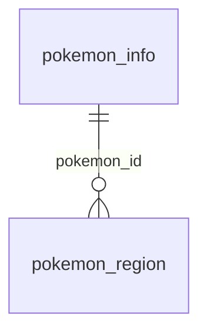

# 데이터베이스
----------------------------------------------------------------
## DB 정보

  * DB : PostgreSQL
  * Name : pokemon_database

## ERD

* ### Pokemon_info table

| key  | Name         | column         | type            | Default Data    | isNull |
| :--: | :----------- | :------------- | :-------------- | :-------------- | :----- |
|  PK  | 번호          | `id`           | `number`        | `Auto Increase` | false  |
|      | 이름          | `name`         | `string`        |                 | false  |
|      | 리전폼         | `isRegion`     | `boolean`       | `false`         | false  |
|      | 전체 타입      | `type`         | `Array<string>` |                 | false  |
|      | 타입 1        | `type_single1` | `string`        |                 | false  |
|      | 타입 2        | `type_single2` | `string`        |                 | true   |
|      | 진화 여부      | `is_evolution` | `boolean`       | `false`         | false  |
|      | 첫 등장 세대    | `generation`   | `number`        |                 | true   |

* ### Pokemon_region

| key  | Name        | column         | type            | Default Data         | isNull |
| :--- | :---------- | :------------- | :-------------- | :------------------- | :----- |
| PK   | 번호         | `id`           | `number`        | `Auto Increase`      | false  |
| FK   | 포켓몬 번호    | `pokemon_id`   | `number`        | `Pokemon_info Table` | false  |
|      | 지역         | `region`       | `string`        |                      | false  |
|      | 전체 타입     | `type`         | `Array<string>` |                      | false  |
|      | 타입 1       | `type_single1` | `string`        |                      | false  |
|      | 타입 2       | `type_single2` | `string`        |                      | true   |

